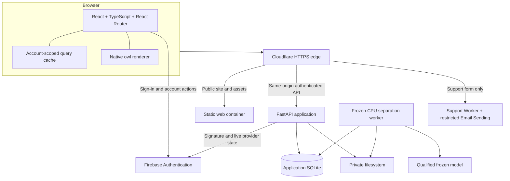

# StethoFuse architecture

StethoFuse separates identity, application authorization, private media and frozen-model inference. This describes the current application, rather than the historical Flask prototype or a proposed rewrite.

## System map



## Source boundaries

| Location | Owns |
| --- | --- |
| `app/main.py` | Protected application entrypoint |
| `app/access_foundation/` | Identity contracts, token validation and access rules |
| `app/m1/` | HTTP routes, SQLite store, jobs, protected media and current-user verification |
| `frontend/src/studio/` | Current public listening studio, appearance and localization |
| `frontend/src/pages/`, `components/`, `data/` | Account flows, workspace screens, UI, adapters and session state |
| `frontend/src/components/owl*` | Approved native GPU/software rendering and verified asset transport |
| `services/stethofuse-support/` | Bounded support submission and escaped HTML/plain-text mail |
| `services/stethofuse-account-mail/` | Tested, unactivated custom verification/recovery delivery; existing identity is preserved |
| `services/stethofuse-cache/` | Public cache eligibility and private-route bypass |
| `deploy/` | Separate web/API/worker containers and qualified dependency contracts |
| `tests/`, `frontend/tests/` | Isolated API tests, browser acceptance and native-renderer checks |
| `evaluation/`, `research/`, `scripts/` | Research pipeline and dated reproducibility evidence |

Legacy source and research contracts remain available. An optional method or historical document does not imply it is active in production.

## Identity and authorization

1. The official Firebase browser SDK signs the user in. Production configuration is validated against the selected existing web app.
2. The client sends the current Firebase ID token in `Authorization: Bearer` to same-origin `/api`.
3. FastAPI verifies signature, issuer, audience and time claims, then checks current provider account state through Firebase Auth REST. The configured API key identifies the project; it does not assign roles.
4. SQLite maps the verified UID to a trusted account. Email verification, active status, role, ownership and grants are enforced server-side.
5. Media endpoints recheck access when serving original or derived bytes. No private directory is mounted as a public static directory.

Public registration cannot choose an elevated role. Administrators manage accounts but do not automatically own their recordings. Analyst access is resource-specific and revocable. Self-administration and last-active-administrator protections prevent accidental administrative lockout.

Browser identity uses session persistence. This is JavaScript-accessible SDK state, not an HttpOnly-cookie claim. No Firebase administrator refresh token, service-account key or production secret belongs in a frontend build or repository.

## Recording and separation lifecycle

```mermaid
sequenceDiagram
    actor Owner
    participant UI as Browser
    participant API as FastAPI
    participant DB as SQLite
    participant W as ML worker
    participant FS as Private files
    Owner->>UI: Preview microphone capture or PCM WAV
    UI->>API: Authenticated upload
    API->>FS: Save validated original privately
    API->>DB: Create owner-linked recording
    UI->>API: Request separation
    API->>DB: Queue authorized job
    W->>DB: Claim job
    W->>FS: Read original; produce heart/lung outputs
    W->>DB: Publish linked result or explicit failure
    UI->>API: Read job and authorized aligned tracks
    API-->>UI: Status, metadata and protected audio
```

Uploads are bounded to 25 MiB and supported PCM WAV. The original remains unchanged. Worker jobs are persisted; the web server does not pretend an unavailable model completed a run. Outputs retain source and processing context. The production model is a fixed, separately qualified CPU artifact. A website release cannot update its weights, API/worker image pins or schema.

T9 recordings and frozen evaluation evidence are not UI fixtures, demo material or routine test inputs. Synthetic non-patient audio is used for application acceptance. Published samples require explicit dataset provenance and terms.

## Caching and startup

- **Public homepage:** a narrowly scoped five-minute edge cache; browser HTML remains `no-store`. Releases purge only the homepage URL and verify packaged HTML identity.
- **Fingerprint assets:** native owl packet URLs contain a content hash, receive immutable public caching and are checked with full SHA-256 before decoding.
- **Private paths:** account/action routes, `/api`, protected media, mutations and deployment identity bypass the public cache. There is no broad service-worker cache of authenticated responses.
- **Client data:** TanStack Query data is scoped to identity, cleared on identity changes, and never used as an authorization decision. Server checks remain authoritative after a cache hit.

The homepage has an early, self-contained loading surface. It becomes interactive only after application initialization and a verified nonblank native owl frame, or an explicit still-pose choice. The first packet prepares nine registered views; a background packet extends the same renderer to 18. Together they reconstruct all original 142 resources exactly. Reach expands through the existing damping without changing character identity or its anchor.

Reduced motion, touch and data-saving conditions use the approved still pose. Failed background extension retains the working initial motion field. Network, integrity and application failures have separate retry behavior. Download progress is measured, not a decorative timer.

## Support and account email

The same-origin support Worker validates bounded JSON, enforces origin and rate limits, escapes visitor content, and sends HTML plus plain text to the configured owner destination through a restricted native Cloudflare binding. The visitor's address is reply-to; no email application is launched. A `202` means provider acceptance, not proof that a person opened the message.

Firebase owns verification and password-recovery actions. The app provides themed action-handler pages and one recovery flow. The current project rejects account-email body/callback customization with `EMAIL_TEMPLATE_UPDATE_NOT_ALLOWED`. A dedicated custom-delivery service and capability-based browser adapter are now implemented and tested. Real project-bound one-use link generation, verification, reset, new-password login and UID preservation were verified with a disposable provider-only identity, then independently cleaned up.

Account delivery uses a separate Worker and **Resend Free**, preserving identity and the existing Support sender. The owner rejected every payment. Actual free quotas (100/day,3,000/month), dedicated sender DNS and a sending-only domain-restricted credential were verified. A distinct Google identity has only `firebaseauth.users.sendEmail`; the owner's local administrator credential never becomes a runtime secret. A protected preview must prove real delivery and one-use actions before public activation. Until then, the browser retains the existing sender. Quota failures cannot trigger purchases or a paid fallback. [Account email delivery](docs/ACCOUNT_EMAIL_DELIVERY.md) records the decision, proof scopes and current activation boundary.

## Deployment, preservation and recovery

The existing owner installation runs **status → build → qualify → preflight → deploy → evidence → status** from any working directory. It authenticates exact source/image/archive identities and holds an exclusive shared deployment lock. Web releases preserve fixed API/worker images, Compose behavior, data layout, model, credentials and foreign application/network state.

Before mutation, the release preserves an authenticated previous-image archive and fresh database/private-file guards. Health, worker readiness, origin/Windows/public identity and anonymous denial are checked after activation. Guarded rollback restores runtime and the matching recovery pin while preserving newer data; it does not restore a stale database. A consumed failed checkpoint requires inspected recovery, not a renamed release or disabled guard.

Backups are separate from deployment. An app-scoped backup must capture consistent SQLite and private files, preserve ownership/modes and model identity, verify encrypted delivery and restore into an isolated location. A guest restore alone does not prove Windows delivery, physical off-device custody, shared-host recovery or a cold boot. The dated completion record distinguishes these claims.

## Evidence and limits

Checks are layered: isolated API/authorization tests; actual frozen-model checks with synthetic data; fixture-based role layouts; real-provider/live checks; and physical capture checks. Builds, HTTP health and accessibility automation cannot establish clinical quality, real-device capture behavior or owner visual acceptance. Results and unverified boundaries belong in [the completion record](docs/COMPLETION_2026-11-05.md).
