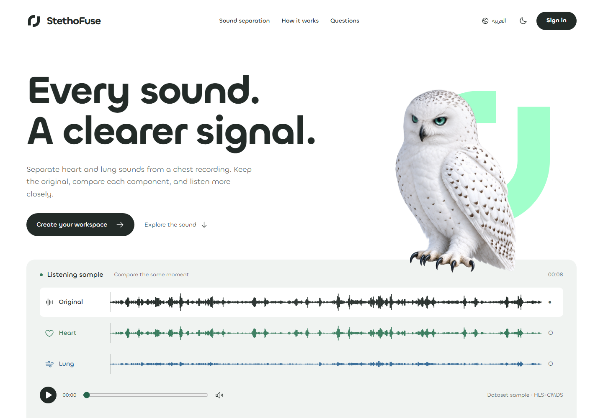
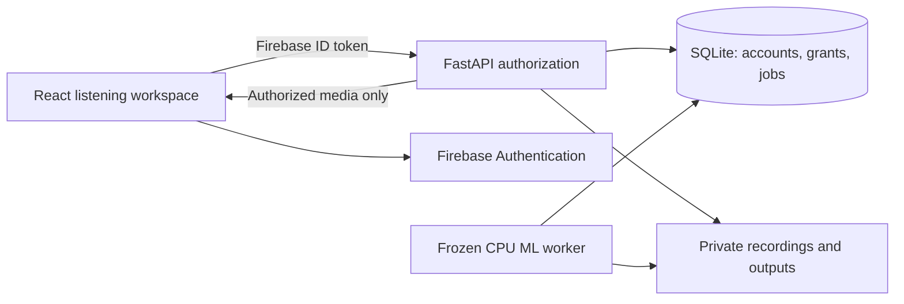

<div align="center">
  <picture>
    <source media="(prefers-color-scheme: dark)" srcset="assets/readme/stethofuse-white.svg">
    
  </picture>
  <h1>Every sound. A clearer signal.</h1>
  <p>A private workspace for cardiopulmonary sound separation.<br>Record, separate, listen and review — with the original always in context.</p>
  <p><a href="https://stethofuse.ashraf-alsaloul.com/">Open StethoFuse</a> · <a href="#getting-started">Get started</a> · <a href="ARCHITECTURE.md">Architecture</a> · <a href="CONTRIBUTING.md">Contribute</a></p>
  <p>
    
    
    
    
    
    
    
    
  </p>
</div>

> **Research and education.** StethoFuse does not diagnose conditions, recommend treatment or replace professional judgment. Upload only recordings you are entitled to use, without patient identifiers.

<picture>
  <source media="(prefers-color-scheme: dark)" srcset="assets/readme/studio-night.png">
  
</picture>

## What you can do

- **Record or upload.** Capture microphone audio in a supported browser, or upload a PCM WAV recording up to 25 MiB. Preview before saving.
- **Separate and compare.** Queue the frozen CPU model, keep the original unchanged, and compare aligned heart and lung outputs with waveforms.
- **Keep a private library.** Recordings, processing history, settings and notifications belong to an authenticated account.
- **Invite a second pair of ears.** Grant an analyst access to a specific resource, receive a review, and revoke access when needed.
- **Work in English or Arabic.** RTL layout, a mirrored pointer-following owl, day/night appearance and reduced motion.
- **Get help in the app.** The support form submits a branded HTML email through Cloudflare; visitors do not need to open an email client.

### Access is explicit

| Account | Responsibility | Private audio access |
| --- | --- | --- |
| Healthcare staff | Own recordings and separation runs | Own resources; explicit grants where applicable |
| Audio analyst | Review assigned recordings | Only resources explicitly shared with that analyst |
| Administrator | Manage accounts and operational metadata | No automatic access to other people's audio |

Registration creates a healthcare-staff account. Roles come from trusted backend records, never a browser selector. Email verification is required before entering the private workspace.

## Getting started

### Explore the interface

Use **Node.js 24** and npm. The development-only demo uses fictional, disposable browser data and does not connect to production accounts, recordings or inference.

```sh
git clone --branch feature/forest-world-prototype https://github.com/ASHRAF-2004/StethoFuse.git
cd StethoFuse/frontend
npm ci
npm run dev:demo
```

Open **http://127.0.0.1:4182**. Production builds cannot enable demo identity.

The current product branch is linked above and published in [PR #12](https://github.com/ASHRAF-2004/StethoFuse/pull/12). The default branch is preserved until its review is merged.

### Run the connected application

Start with [CONTRIBUTING.md](CONTRIBUTING.md) for isolated API paths, the existing Firebase web-app configuration and test commands. `.env.example` contains configuration names, not privileged credentials. A production build intentionally fails when the selected Firebase configuration is missing or invalid.

```sh
cd frontend
npm ci
# Configure frontend/.env.local using frontend/.env.example.
npm run build
npm run preview
```

The frontend uses same-origin `/api`. Vite can proxy it to an explicitly configured loopback API during development. Private recordings and model weights are **not distributed in Git**. Model execution requires the qualified frozen model and worker configuration; the UI demo does not simulate scientific results.

## How it works



The API checks the signed identity and its current provider state, then applies account status, role, ownership and resource-specific grants. Public assets can be cached; private API responses, identity state and protected media stay outside the public cache. See [ARCHITECTURE.md](ARCHITECTURE.md) for the complete boundaries.

### The listening owl

The approved owl uses a registered, two-axis native renderer, rather than a repeating flight clip. Two integrity-checked packages prepare a useful initial motion field before extending to all 18 source views. The original artwork and geometry are preserved byte-for-byte. Touch, data-saving and reduced-motion users receive the approved still pose. A still image is never reported as a successful animated first frame.

## Repository map

```text
app/                  FastAPI, identity, authorization and application persistence
frontend/             React application, native owl renderer and browser checks
services/             Cloudflare support mail and narrowly scoped public-cache policy
deploy/               Containers, dependency locks and operational runbooks
tests/                Python API, authorization, processing and research-contract tests
scripts/              Research, evaluation and operational utilities
evaluation/           Evaluation code and preserved experiment definitions
research/             Research notes and reproducibility context
assets/readme/        Current branding and actual application previews
docs/                 API contracts, design decisions and dated evidence
```

The academic report is maintained separately. Historical milestone documents describe their dated state; they are not the current product specification.

## Quality and operations

CI checks the frontend build, native asset integrity, focused browser journeys and isolated Python authorization tests. Browser fixtures, real-provider tests and physical-device checks are different evidence categories; one does not stand in for another.

Production releases use the owner's guarded tooling: **build → qualify → preflight → deploy → evidence**. Exact-image checks, an exclusive lock, data-preservation checks and a verified previous-image rollback remain mandatory. This repository does not automatically deploy on a push, change other applications or run a shared backup.

- [Current completion and verification record](docs/COMPLETION_2026-11-05.md)
- [Architecture and trust boundaries](ARCHITECTURE.md)
- [Contributor setup and checks](CONTRIBUTING.md)
- [Changes](CHANGELOG.md)
- [Security reporting](SECURITY.md)
- [ML worker runbook](deploy/ML_WORKER_RUNBOOK.md)
- [Deployment configuration](deploy/README.md)

## Project and attribution

**Machine Learning-Based System for Cardiopulmonary Sound Separation** — an academic research application by **Ashraf Ali Hussain Al-Saloul / أشرف علي حسين الصلول**.

No project-wide open-source license has been declared. Public visibility does not grant a license to redistribute the code, artwork, datasets or model weights. Third-party software, fonts and datasets retain their own terms; see [THIRD_PARTY_NOTICES.md](THIRD_PARTY_NOTICES.md).

<div align="center"><sub>© 2026 Designed and developed by Ashraf Ali Hussain Al-Saloul</sub></div>
