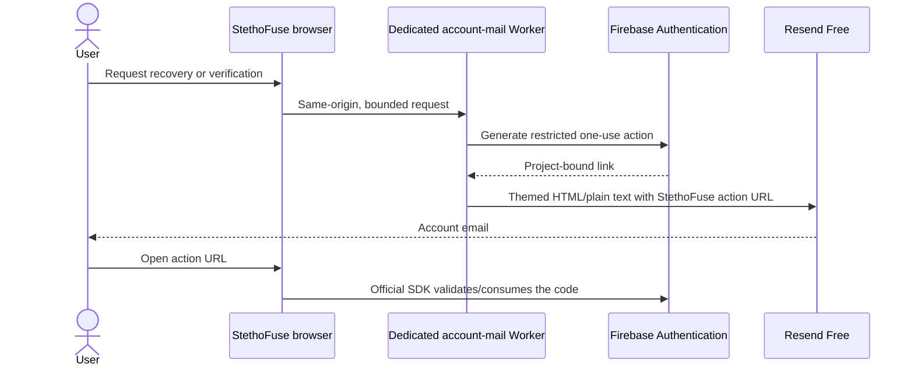

# Account email: identity and delivery are separate

Firebase is not the only authentication option, and Firebase's email templates are
not the only way to deliver verification or password-recovery messages. Replacing
working identity is unnecessary to fix restricted email branding.

## Selected design

Keep the current Firebase identities and secure one-use actions. A dedicated
Cloudflare Worker uses **Resend Free** to deliver the same HTML material as the
website. This preserves UIDs, passwords, roles, grants and recording ownership.
The owner explicitly declined all payments. No paid Cloudflare sending binding,
subscription, payment-required trial, automatic upgrade or overage is permitted.
Credentials are provisioned privately through the existing owner connections;
the owner does not need to copy secrets into chat.

## Verified status — 5 November 2026

The frontend adapter is live in `20261105T101558Z-aa1c40a98ebd`, source
`8dd23ecaa84b3baaf29469a9f91c9b60ab3b6841`. PR #12 and the follow-up [PR #13](https://github.com/ASHRAF-2004/StethoFuse/pull/13)
are merged to main. Live recovery correctly selects the existing sender because the
native-mail service is absent; Arabic action URLs initialize RTL and remove the
sensitive query. These browser checks intercepted Google responses and sent no mail.
Root/Windows/public health/version/auth, data and foreign-resource guards passed.
API/worker pins stayed fixed; current HTML matched the package after scoped purge.

| Boundary | Evidence |
| --- | --- |
| Provider template edit | Existing project rejects body and callback edits with `EMAIL_TEMPLATE_UPDATE_NOT_ALLOWED`; no settings were changed |
| Alternative secure links | Actual project verification/reset links generated with existing local owner access; verification, new-password login, same UID and used-code rejection passed |
| Test cleanup | The single new provider-only identity was deleted and independently looked up as absent; application data and other users untouched |
| Worker security | 56 isolated tests passed: identity/link binding, private preview, free-only transport, quotas/errors, no paid fallback and safe logs |
| Frontend adapter | 14 tests passed, including existing-provider fallback and no duplicate fallback after a failed native submission |
| Compiled browser | Seven new native-mail/Arabic-link states and six existing operation-bound SDK states passed; responses intercepted |
| Real Cloudflare capability | Ordinary recipient rejected with `E_RECIPIENT_NOT_ALLOWED`; temporary test Worker and unique route removed, original routes preserved |
| Free provider access | Owner Google OAuth connected; actual API confirms 100/day and 3,000/month limits, with zero initially used |
| Sender | Dedicated `notify.stethofuse.ashraf-alsaloul.com` verified; all seven prior DNS records unchanged |
| Credentials | Resend sending-only key denies management access; separate Google role has only `firebaseauth.users.sendEmail`, all other IAM policy preserved |
| Public delivery | Private preview and real inbox/action validation precede activation; existing Firebase emails stay active during setup |

The earlier paid-mail question is **declined**, not pending. The free Support sender
continues using its preverified owner destination. Account mail instead uses the
confirmed Resend Free account over HTTPS. Free quotas stop delivery when exhausted;
the application never purchases capacity or retries through a paid sender. The
runtime credential can send only from the dedicated domain and cannot administer
the account. Owner/admin OAuth credentials remain local, outside runtime and Git.

The public mail route remains absent until a secret-protected preview passes real
inbox, one-use action and browser tests. The frontend then discovers the configured
service without changing the identity provider or requiring another web release.

## Alternatives considered

| Option | Effect on this project |
| --- | --- |
| Existing Firebase delivery | Works today without a new sender subscription; this project's template/body/URL controls are restricted |
| Firebase identity + Resend Free delivery | Selected; preserves users and permissions, with verified free quotas and privately provisioned restricted credentials |
| Supabase Auth | A possible identity replacement; it still needs configured production mail delivery and a planned identity migration |
| Self-hosted authentication, such as Better Auth | Offers control but adds database, session, abuse-prevention, migration and email operations; it does not eliminate trusted server credentials |

A new provider is an architectural option, not a prerequisite for branded email.
Do not export existing users, reset passwords or replace UID mappings as a shortcut.

Implementation, deployment boundaries and focused commands are in
[the account-mail service](../services/stethofuse-account-mail/README.md).

## Primary references

- [Firebase: generate email action links for custom delivery](https://firebase.google.com/docs/auth/admin/email-action-links)
- [Google: project-scoped action-link permission and REST method](https://docs.cloud.google.com/identity-platform/docs/reference/rest/v1/projects.accounts/sendOobCode)
- [Google: supported custom-role permissions](https://docs.cloud.google.com/iam/docs/custom-roles-permissions-support)
- [Cloudflare: email sending and recipient restrictions](https://developers.cloudflare.com/email-service/configuration/send-bindings/)
- [Cloudflare: Email Service pricing](https://developers.cloudflare.com/email-service/platform/pricing/)
- [Cloudflare: Workers pricing](https://developers.cloudflare.com/workers/platform/pricing/)
- [Resend: free quotas and limits](https://resend.com/docs/knowledge-base/account-quotas-and-limits)
- [Resend: supported OAuth connection](https://resend.com/changelog/oauth-support)
- [Resend: domain-restricted sending credentials](https://resend.com/changelog/new-api-key-permissions)
- [Supabase: production SMTP](https://supabase.com/docs/guides/auth/auth-smtp)
- [Better Auth: email/password authentication](https://www.better-auth.com/docs/authentication/email-password)
