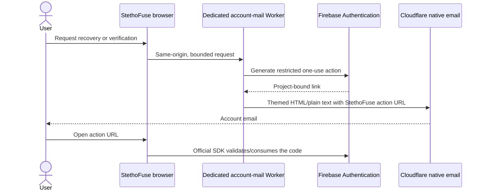

# Account email: identity and delivery are separate

Firebase is not the only authentication option, and Firebase's email templates are
not the only way to deliver verification or password-recovery messages. Replacing
working identity is unnecessary to fix restricted email branding.

## Selected design

Keep the current Firebase identities and secure one-use actions. Deliver the emails
through a dedicated, app-scoped Cloudflare Worker with the same HTML material as
the website. This preserves account UIDs, passwords, roles, grants and private
recording ownership. It avoids a separate SMTP password; a narrowly scoped Google
service identity is still necessary for server-side action-link generation.
The owner should not need to manually copy credentials between services.

## Verified status — 5 November 2026

The frontend adapter is live in `20261105T101558Z-aa1c40a98ebd`, source
`8dd23ecaa84b3baaf29469a9f91c9b60ab3b6841`. PR #12 and the follow-up [PR #13](https://github.com/ASHRAF-2004/StethoFuse/pull/13)
are merged to main. Live recovery correctly selects the existing sender because the
native-mail service is absent; Arabic action URLs initialize RTL and remove the
sensitive query. These browser checks intercepted Google responses and sent no mail.
Root/Windows/public health/version/auth, data and foreign-resource guards passed.
API/worker pins stayed fixed; current HTML matched the package after scoped purge.

| Boundary | Evidence |
| --- | --- |
| Provider template edit | Existing project rejects body and callback edits with `EMAIL_TEMPLATE_UPDATE_NOT_ALLOWED`; no settings were changed |
| Alternative secure links | Actual project verification/reset links generated with existing local owner access; verification, new-password login, same UID and used-code rejection passed |
| Test cleanup | The single new provider-only identity was deleted and independently looked up as absent; application data and other users untouched |
| Worker security | 36 isolated tests passed: signed/scoped token, exact project/links, recipient binding, no public codes, origin/body/rate limits and safe logs |
| Frontend adapter | 14 tests passed, including existing-provider fallback and no duplicate fallback after a failed native submission |
| Compiled browser | Seven new native-mail/Arabic-link states and six existing operation-bound SDK states passed; responses intercepted |
| Real Cloudflare capability | Ordinary recipient rejected with `E_RECIPIENT_NOT_ALLOWED`; temporary test Worker and unique route removed, original routes preserved |
| Public delivery | Custom account-mail service is **not active**; existing Firebase emails continue working |

The free Support sender is restricted to a preverified owner inbox. It cannot be
reused as an arbitrary-recipient account mailer. Cloudflare's current native sending
capability requires Workers Paid; the published minimum is US$5/month with 3,000
emails/month included, then US$0.35/1,000 emails. Other Workers overages can apply.
No subscription, billing, runtime mail key or new Google service account was created.
The new recurring charge requires explicit owner authorization, requested separately
from the already-authorized repository merge.

## Alternatives considered

| Option | Effect on this project |
| --- | --- |
| Existing Firebase delivery | Works today without a new sender subscription; this project's template/body/URL controls are restricted |
| Firebase identity + custom delivery | Fixes mail branding while preserving users and permissions; selected implementation is ready for provider activation tests |
| Supabase Auth | A possible identity replacement; it still needs configured production mail delivery and a planned identity migration |
| Self-hosted authentication, such as Better Auth | Offers control but adds database, session, abuse-prevention, migration and email operations; it does not eliminate trusted server credentials |

A new provider is an architectural option, not a prerequisite for branded email.
Do not export existing users, reset passwords or replace UID mappings as a shortcut.

Implementation, deployment boundaries and focused commands are in
[the account-mail service](../services/stethofuse-account-mail/README.md).

## Primary references

- [Firebase: generate email action links for custom delivery](https://firebase.google.com/docs/auth/admin/email-action-links)
- [Google: project-scoped action-link permission and REST method](https://docs.cloud.google.com/identity-platform/docs/reference/rest/v1/projects.accounts/sendOobCode)
- [Google: supported custom-role permissions](https://docs.cloud.google.com/iam/docs/custom-roles-permissions-support)
- [Cloudflare: email sending and recipient restrictions](https://developers.cloudflare.com/email-service/configuration/send-bindings/)
- [Cloudflare: Email Service pricing](https://developers.cloudflare.com/email-service/platform/pricing/)
- [Cloudflare: Workers pricing](https://developers.cloudflare.com/workers/platform/pricing/)
- [Supabase: production SMTP](https://supabase.com/docs/guides/auth/auth-smtp)
- [Better Auth: email/password authentication](https://www.better-auth.com/docs/authentication/email-password)
